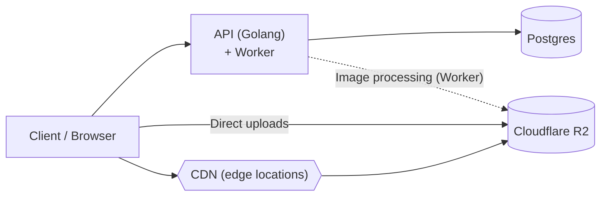

# High Level Design (HLD)

## Components

| Component | Role |
|---|---|
| Client (browser) | Calls the API for data; uploads images directly to object storage; fetches images via CDN |
| API (Golang) | Core backend service. Reads/writes Postgres. Hosts the background worker |
| Worker (inside API) | Async image processing (resize/optimise) against R2 |
| Postgres | Primary relational datastore |
| Cloudflare R2 | Object storage for listing images |
| CDN (edge locations) | Serves images from edge locations, backed by R2 |

## Flows

1. **API requests** — client → API (Golang) → Postgres.
2. **Direct uploads** — client uploads images straight to Cloudflare R2, bypassing the API, so large payloads never pass through the API servers.
3. **Image processing** — the worker picks up uploaded images and processes them, writing results back to R2.
4. **Image delivery** — client requests images via the CDN; edge locations cache them, falling back to R2 on a miss.

## Notes

- Worker runs in the same deployable as the API (separate goroutines/pool), not a separate service.
- Open questions to settle: how the API authorises direct uploads (presigned URLs are the usual answer), and how the worker is triggered (DB-backed job queue vs. in-process channel vs. R2 event).
