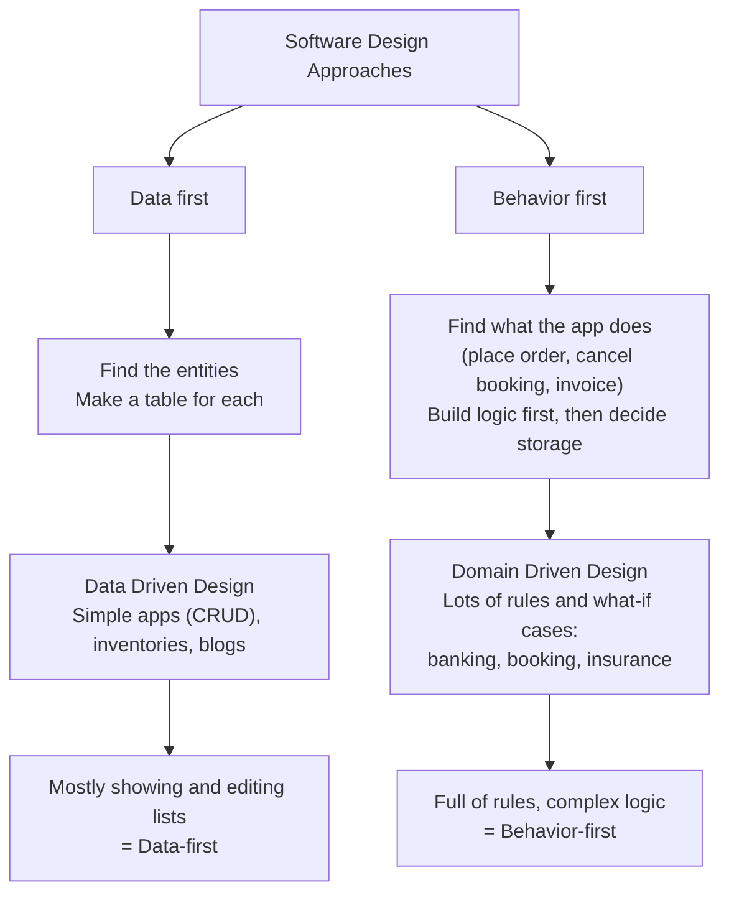

# Design Approach: Data-Driven Design

**Decision:** this project uses **Data-Driven Design (data first)**, not Domain-Driven Design.

## The two approaches

| | Data first | Behavior first |
|---|---|---|
| Start by | Finding the things (entities) and making a table for each | Finding what the app does (place order, cancel booking, invoice) |
| Then | Build logic around the tables | Build the logic first, then decide how to store the data |
| Name | **Data-Driven Design** | Domain-Driven Design |
| Fits | Simple apps (CRUD), inventories, blogs | Apps with lots of rules and "what if" cases: banking, booking, insurance |
| Nature of app | Mostly showing and editing lists | Full of rules and complex logic |

## Why data-driven for this project

An OLX-style marketplace is mostly listing, searching, creating and editing records (users, categories, listings, images, favourites, chats). There is little complex business-rule logic, so we model the entities and tables first and keep the service layers thin.

## What this means in practice

- Start from the schema: identify entities, make a table for each, define relations and indexes.
- Handlers/services are CRUD-oriented around those tables; no heavy aggregate/domain-model layer.
- Revisit if rule-heavy features appear (e.g. payments, promoted-listing billing, dispute flows); those parts may warrant a behavior-first treatment.
